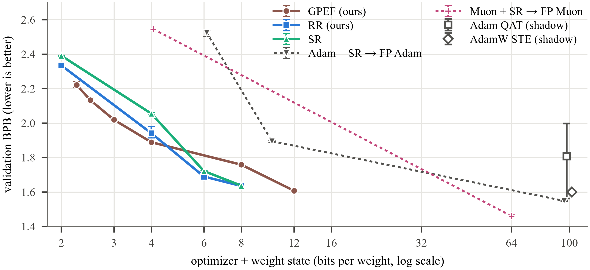
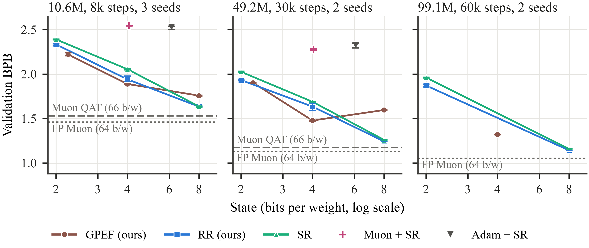

# 2-bit training at a fixed optimizer-state budget

CS182 project code. Every method here trains a byte-level transformer from scratch with **2-bit deployed weights**.
The question is how validation bits per byte (bpb) depends on how much state each weight carries during training,
counting the weight, any stored residual and any optimizer moments, in bits per weight (b/w).

The methods compared:

- **SR and RR (ours).** A normalized gradient step that keeps a B-bit sub-grid residual. The residual is rounded to
  the 2-bit grid either by stochastic rounding (SR) or by rotation rounding (RR), which uses the threshold
  frac(u0 + tφ). See `srq_ext.py`, with the derivation in `docs/rotation_rounding.tex`.
- **GPEF (ours).** Learned group codebooks with error feedback (`team_ext.py`), plus larger groups for 2.25-3 b/w
  (`team_grp.py`).
- **Baselines.** Muon and Adam in full precision, with QAT, and with SR-quantized moments, plus AdamW STE.

All results are on byte-level WikiText-103, validation split only.

## Results (val bpb, lower is better)

Each cell is the mean over seeds at the learning rate that scored best for seed 0. That is 3 seeds at 10.6M and
2 at 49.2M and 99.1M.

| state b/w | method | 10.6M | 49.2M | 99.1M |
|---|---|---|---|---|
| 2 | SR | 2.391 | 2.026 | 1.961 |
| 2 | RR | 2.334 | 1.933 | **1.872** |
| 2.25 | GPEF, groups of 256 | **2.221** | **1.902** | |
| 4 | SR / RR | 2.055 / 1.941 | 1.689 / 1.635 | |
| 4 | GPEF | **1.889** | **1.478** | **1.321** |
| 8 | SR / RR | 1.637 / **1.635** | 1.260 / **1.243** | 1.159 / **1.143** |
| 8 | GPEF, 4-bit residual | 1.758 | 1.596 | |
| 4-6 | Muon+SR / Adam+SR | 2.545 / 2.524 | 2.277 / 2.323 | |
| 64 | Muon (FP) | 1.460 | 1.131 | 1.053 |
| 66 / 98 / 102 | Muon QAT / Adam QAT / AdamW STE | 1.530 / 1.807 / 1.599 | 1.173 / 1.186 / 1.221 | |

- RR beats SR at every budget and size, with a near-tie at 8 b/w at 10.6M (1.635 vs 1.637). At 49.2M and 99.1M, every RR seed beats every SR seed.
- GPEF is best at 2.25-4 b/w, and its lead grows with model size.
- At 8 b/w, RR is 0.09 bpb behind full-precision Muon at 99.1M, down from 0.18 at 10.6M.
- At 49.2M and 99.1M, many selected learning rates sit at the edge of a small grid, so those margins are not fully
  tuned.




## Reproducing the report's figures and tables

The run records in `results/*.jsonl` are committed, so every figure and table rebuilds in under a minute on a CPU,
**without retraining**:

```bash
pip install matplotlib
python figures/paper_figs.py      # Fig. 1-3 -> figures/fig{1,2,3}_*.pdf/.png
python figures/paper_tables.py    # Tables 3-4 -> figures/lr_table.tex, figures/ablation_table.tex
```

| report item | script | inputs (`results/`) |
|---|---|---|
| Fig. 1, quality vs state b/w (10.6M) | `figures/paper_figs.py` | `campaign_10M.jsonl` |
| Fig. 2, training curves at matched state (10.6M) | `figures/paper_figs.py` | `campaign_10M.jsonl` |
| Fig. 3, scaling to 49.2M and 99.1M | `figures/paper_figs.py` | `campaign_10M.jsonl`, `10M.jsonl`, `campaign_50M.jsonl`, `campaign_100M.jsonl` |
| Table 3, learning-rate grids (appendix) | `figures/paper_tables.py` | same as Fig. 3 |
| Table 4, GPEF ablations (appendix) | `figures/paper_tables.py` | `campaign_10M.jsonl` |
| Sec. 7, GPEF indices rounded by RR/SR (`gpef_rot@e0`, `gpef_sr@e0`) and on a frozen grid (`gpef_frz@e0_near`) | `team_rot.py`, `team_gpx.py`; `campaigns/campaign_rot.py`, `campaigns/campaign_gpx.py` | `campaign_10M.jsonl` |
| Sec. 7, rotation-rounded 4-bit residual (`gpefx@e4g32_narrow_rot_b0.99`; 1.646 at 10.6M, 1.437 at 49.2M) | `team_gpx.py`; `campaigns/campaign_gpx.py`, `campaigns/campaign_gpefix_50M.py`; record `docs/RECORD_flip-vs-srqrr-003.md` | `campaign_10M.jsonl`, `campaign_50M_gpefix.jsonl` |
| Sec. 7, zero-update diagnostic (index moves per step at lr 0) | `python tests/zero_lr.py .` (CPU, about a minute) | none |

**Selection rule**, used by every script:

- For each method and size, the selected learning rate is the one with the lowest **seed-0** val bpb among
  non-diverged runs.
- The reported value is the mean over all seeds at that learning rate.
- Error bars and bands show the min-max over those seeds.

**Test split.** The test split is sealed. `drive.py` aliases `test` to `val` and drops every `test_*` field, so
`test.bin` is never read.

## Retraining

- **Software.** Python 3.12, PyTorch 2.9.1 with CUDA 12.8, numpy, and `datasets` for data preparation.
- **Data.** The datasets are public and are not included in the repo. `python prep.py` downloads them and builds
  byte-level WikiText-2 (pilot) and WikiText-103 (all other sizes) in `data/`.
- **Hardware used.** The pilot and 10.6M runs used an RTX 5080 (16 GB), several at a time. The 49.2M and 99.1M runs
  used an L40S, one run per GPU.

One run is a single command:

```bash
python drive.py run --preset 10M --method srq_rot@b2 --lr 0.03 --seed 0 --eval_windows 2000 --out results/runs.jsonl
```

Each campaign is resumable: it skips any `(method, lr, seed)` already in its output. Its learning-rate protocol is in
the script's header. To start a campaign fresh, move its output file aside first.

| size (preset) | command(s), in order | writes (`results/`) | runs | GPU-h |
|---|---|---|---|---|
| 2.65M pilot and 10.6M | `campaigns/campaign.py`, `campaign_10M_v2.py`, `campaign_rot.py`, `campaign_team.py`, `campaign_hi.py`, `campaign_gsz.py`, `campaign_gpx.py`, `campaign_gpf.py` | `campaign_pilot.jsonl`, `campaign_10M.jsonl` | 476 | 65 |
| 10.6M Muon QAT | `campaigns/ladder.py` | `10M.jsonl` | 13 | 7 |
| 49.2M (`50M`) | `campaigns/campaign_50M.py GPU_A GPU_B` | `campaign_50M.jsonl` | 57 | 92 |
| 99.1M (`100M`) | `campaigns/campaign_100M.py GPU_A GPU_B` | `campaign_100M.jsonl` | 18 | 79 |

- **Run time.** A 10.6M run takes under 0.6 h. A 49.2M run takes 1.2-2.5 h on an L40S, and a 99.1M run 4.2-5.2 h.
- **Pruned methods.** The 10.6M result files also hold exploratory methods (Flip, GPEF variants) whose code has
  been pruned from this repo. The figure scripts select only the methods in the report.

## Layout

| path | contents |
|---|---|
| `qtrain.py` | Training harness: the model, data loading and the baseline optimizers. It also contains the teammate's Flip optimizer, which is not in the report. |
| `drive.py` | Runs one (method, lr, seed) and appends a val-only JSON record. |
| `prep.py` | Downloads and builds the datasets. |
| `srq_ext.py` | SR and RR: `srq_sr@bB`, `srq_rot@bB`. |
| `team_ext.py`, `team_grp.py` | GPEF (`gpef@eE`, `gpef@e0gG`), Adam+SR (`adam_sr@mB`) and AdamW STE. |
| `team_gpf.py` | GPEF ablation variants used in the appendix: clip, FP8/FP4 residual, momentum. |
| `campaigns/` | The executed sweep scripts. |
| `results/` | Run records, one JSON object per run. Each has `val_bpb`, `state_bits`, `curve` (train loss every 100 steps) and the full config. |
| `figures/` | Report figures and table, and the scripts that build them. |
| `tests/` | CPU checks for the extensions: on-grid codes, unbiasedness, and equivalence to the reference implementation. |
| `docs/` | Rotation-rounding derivation, and experiment records with design, results and limits for each campaign. |
