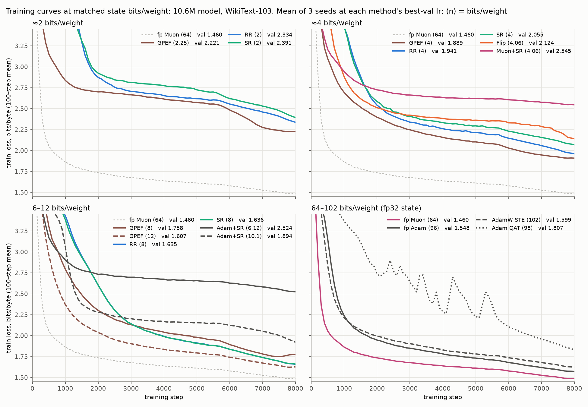
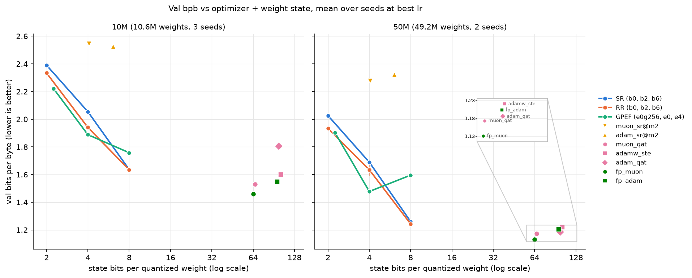
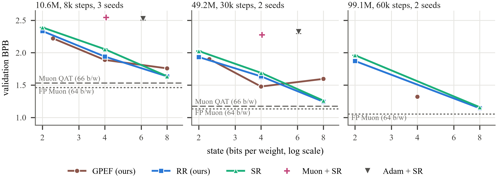

# flip-vs-srqrr: 2-bit training at a fixed optimizer-state budget

Every method here trains a byte-level transformer from scratch with **2-bit deployed weights**. The question is how
validation bits per byte (bpb) depends on how much optimizer + weight state each weight carries, counted in
bits/weight. The families compared are:

- **flip**: the teammate's flip optimizer, with quantized momentum.
- **SR / RR**: a normalized gradient step that stores a B-bit sub-grid remainder. It is rounded by stochastic rounding
  (SR) or rotation rounding (RR, threshold frac(u0 + tφ)).
- **GPEF**: the teammate's group-32 learned codebook with error feedback.
- **Low-bit and fp Adam / Muon** references.

The setup is the teammate's harness ([EthelynHuang/flip-optimizer](https://github.com/EthelynHuang/flip-optimizer)
@ ea4471c). The pilot uses 2.65M quantized weights on WikiText-2. The main rung uses 10.6M on WikiText-103: 8000 steps,
batch 64×256, and 2000 val windows. Learning rates are chosen on val only, and the test split is never read.

## Results (10.6M, val bpb, lower is better)

Each cell is the mean of 3 seeds at the learning rate that scored best on val for seed 0.

| state bits/weight | SR | RR | GPEF | other |
|---|---|---|---|---|
| ≈2 | 2.391 | 2.334 | **2.221** (2.25 b/w) | |
| ≈4 | 2.055 | 1.941 | **1.889** | flip@m2 2.124, Muon+SR 2.545 |
| 6–8 | 1.636 | **1.635** | 1.758 | flip@m4 1.677 (6.1 b/w) |
| 10–12 | | | **1.607** (12 b/w) | Adam+SR@m4 1.894 (10.1 b/w) |
| 64–102 | | | | fp Muon **1.460**, Muon QAT 1.530, fp Adam 1.548, AdamW STE 1.599, Adam QAT 1.807 |

- At 2–4 bits/weight, GPEF is best and RR beats SR.
- At 8 bits/weight, RR and SR tie and beat GPEF@e4 at the same budget. They also beat flip@m4, which has 6.1 bits/weight.
- Quantized Muon and Adam momentum (Muon+SR, Adam+SR) is far behind at the same budget.

The full record is in [docs/RECORD_flip-vs-srqrr-001.md](docs/RECORD_flip-vs-srqrr-001.md). It includes the pilot,
the ablations (srqrr refit, rotation × GPEF, symmetric-error ladder, λ-split, and the teammate's GPEF revisions), the
checks, and the interpretation.




## Results at 49.2M (val bpb, lower is better)

The 16 main methods were rerun at 49.2M quantized weights (preset `50M`: d=640, 10 layers, ctx 512, 30k steps,
about 1.8 passes over WikiText-103). Each cell is the mean of 2 seeds at the best seed-0 learning rate; 10M values
are in brackets.

| state bits/weight | SR | RR | GPEF | other |
|---|---|---|---|---|
| ≈2 | 2.026 (2.391) | 1.933 (2.334) | **1.902** (2.221), 2.25 b/w | |
| 4–6 | 1.689 (2.055) | 1.635 (1.941) | **1.478** (1.889) | Muon+SR 2.277 (2.545), Adam+SR 2.323 (2.524) |
| 8 | 1.260 (1.637) | **1.243** (1.635) | 1.596 (1.758) | |
| 64–102 | | | | fp Muon **1.131**, Muon QAT 1.173, Adam QAT 1.186, fp Adam 1.203, AdamW STE 1.221 |

- RR beats SR at every width. At 50M every RR seed beats every SR seed.
- GPEF@e0 leads at 4 bits/weight by more than at 10M (0.157 ahead of RR, was 0.052). GPEF@e4 falls further behind
  at 8 bits/weight (0.353 behind RR, was 0.124).
- RR at 8 bits/weight is 0.070 behind Muon QAT (66 bits/weight), down from 0.104 at 10M.

Several entries, including RR at 2 and 4 bits/weight, had their best learning rate at the edge of the tested grid,
and the 4-bit RR seeds differ by 0.083. Details and limits are in
[docs/RECORD_flip-vs-srqrr-002.md](docs/RECORD_flip-vs-srqrr-002.md).



## Results at 99.1M (val bpb, mean of 2 seeds; 50M in brackets)

Preset `100M` (d=768, 14 layers, 60k steps, about 20 bytes per weight). The 6 methods were chosen by Henry.

| state bits/weight | SR | RR | GPEF | other |
|---|---|---|---|---|
| 2 | 1.961 (2.026) | **1.872** (1.933) | | |
| 4 | | | **1.321** (1.478) | |
| 8 | 1.159 (1.260) | **1.143** (1.243) | | |
| 64 | | | | fp Muon **1.053** (1.131) |

- RR beats SR at both budgets by the same margins as at 50M.
- Most best lrs are at the top of their 2-point grid.
- Details are in [docs/RECORD_flip-vs-srqrr-004.md](docs/RECORD_flip-vs-srqrr-004.md).
- The GPEF error-storage follow-up at 50M is in [docs/RECORD_flip-vs-srqrr-003.md](docs/RECORD_flip-vs-srqrr-003.md).



## Layout

| path | contents |
|---|---|
| `qtrain.py` | Harness: the teammate's `src/qtrain.py` plus a host-sync speed patch. It gives identical results; see the header. |
| `drive.py` | Runs one (method, lr, seed) and appends a JSON record. `test` is aliased to `val`, so test.bin is never read. |
| `prep.py` | Builds byte-level WikiText-2 / WikiText-103 into `data/`. |
| `srq_ext.py` | `srq_sr@bB`, `srq_rot@bB`, and `srqrr@bB` (rotation + per-row scale refit). |
| `team_ext.py` | `gpef@eE`, `adamw_ste`, and `adam_sr@mB`. |
| `team_rot.py`, `team_grp.py`, `team_gpx.py`, `team_gpf.py` | GPEF variants: RR/SR rounding on GPEF codebooks, larger groups, rotation × GPEF error storage, and the teammate's revisions. |
| `campaigns/` | The executed sweep scripts. `campaign.py` defines the protocol; each `campaign_*.py` is one recorded phase. |
| `tests/` | CPU checks for each extension (equivalence to the notebook, on-grid codes, unbiasedness, drift). |
| `results/` | Run records (`campaign_10M.jsonl`, `campaign_50M.jsonl`, `campaign_100M.jsonl`, `campaign_50M_gpefix.jsonl`, `campaign_pilot.jsonl`, plus `10M.jsonl` / `pilot.jsonl` from the scale study). Each record has `val_bpb`, `train_eval_bpb`, `state_bits`, and `curve` (train loss in nats every 100 steps). |
| `figures/` | Every figure and the script that draws it from `results/`. The report's figures (`fig1-3`) come from `paper_figs.py`; its learning-rate table (`lr_table.tex`) comes from `paper_tables.py`. |
| `docs/` | Experiment records, the rotation-rounding derivation (`rotation_rounding.tex`), and the draft. |

Each extension registers its methods into `qtrain` on import and leaves the existing methods unchanged. `drive.py`
imports all of them.

## Running

```bash
python prep.py                                                # data/wt2_pytorch, data/wt103
python drive.py run --preset 10M --method srq_rot@b2 --lr 0.03 --seed 0 --eval_windows 2000 --out results/runs.jsonl
python tests/srq_test.py                                      # CPU, needs data/wt2_pytorch
python campaigns/campaign.py                                  # full protocol; resumable; GPU admission at 72% of 16 GB
uv run --with matplotlib python figures/plot_family_bits.py
uv run --with matplotlib python figures/plot_50M.py --fig    # 50M vs 10M table and figure
uv run --with matplotlib python figures/paper_figs.py        # report figures fig1-3 (pdf + png)
python figures/paper_tables.py                                # report lr table -> figures/lr_table.tex
```

`plot_bits.py` and `plot_curves.py` take `10M` or `pilot` as an argument.
