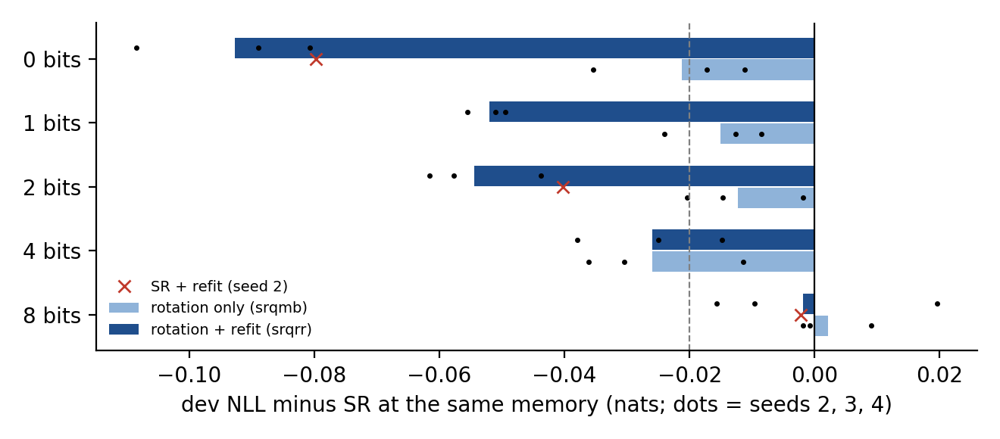
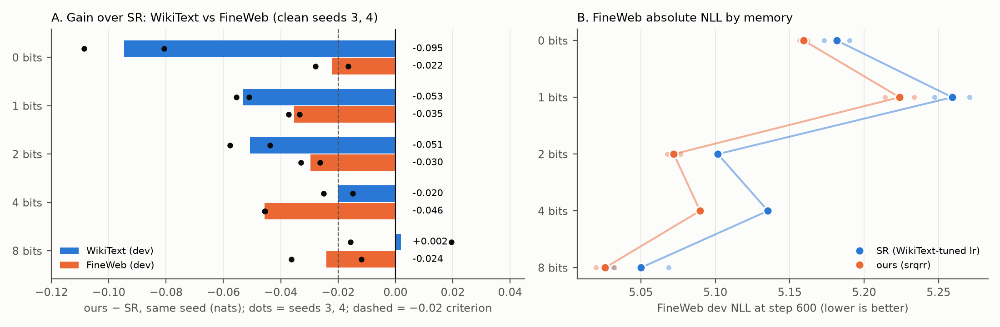

# srqrr: rotation rounding + level refit

srqrr trains 4-bit weights directly. The optimizer may keep only **b extra bits per weight** (b = 0, 1, 2, 4, 8), and it beats stochastic rounding (SR) at the same memory.

**Setting.** Each weight matrix is stored in the group32x4 format:
- 4-bit codes c ∈ {0..15}.
- One FP32 scale θ per 32 weights.
- The deployed weight is W = θ·(c − 7.5).

The optimizer's only per-weight state is a b-bit fraction f. Its position is x = c + f, and only c is deployed.

**Method.** Each step does three things:
1. **Code move.** The same normalized step as SR: x̃ = clip(c + f − η·g / (rms(g)·θ), 0, 15).
2. **Rotation rounding.** Round x̃ onto the 2^−b grid with the threshold u = frac(u₀ + t·φ), where φ = (√5−1)/2.
   - u₀ is regenerated from a fixed seed every step, so it costs no memory.
   - Each step stays unbiased, as with SR.
   - One weight's rounding errors cancel over time instead of adding up as a random walk.
3. **Level refit.** Update each group scale θ by a small, shrunk Newton step computed from the same batch.
   - θ is part of the deployed weight, so this adds no optimizer memory.
   - Each θ pools 32 weights, so it averages gradient noise that the per-weight update cannot.

The derivation is in [WRITEUP.md](WRITEUP.md). §II has the rotation bound and Definition 3 has the full step.

## Results

Setup:
- Model: Pythia-14m, starting from a 4-bit QAT fit.
- Training: 600 steps of continued training, batch 8 × 128 tokens.
- Metric: dev NLL (nats) at step 600; lower is better.
- Learning rates: tuned for SR per b, and reused unchanged for srqrr.
- Comparison: paired by seed.

**WikiText (seeds 2, 3, 4)**

| b (bits/weight) | SR | srqrr | gap (mean) | better |
|---|---|---|---|---|
| 0 | 5.242 | 5.149 | **−0.093** | 3/3 |
| 1 | 5.190 | 5.138 | **−0.052** | 3/3 |
| 2 | 5.075 | 5.020 | **−0.054** | 3/3 |
| 4 | 4.931 | 4.905 | **−0.026** | 3/3 |
| 8 | 4.866 | 4.864 | −0.002 | 2/3 |

For reference, Adam with FP32 moments (8 bytes/weight of state) reaches 4.960. srqrr at b = 4 uses 0.5 bytes/weight.



**Transfer to FineWeb (seeds 3, 4; WikiText-tuned lrs, nothing re-tuned)**

| b | SR | srqrr | gap (mean) | better |
|---|---|---|---|---|
| 0 | 5.182 | 5.159 | −0.022 | 2/2 |
| 1 | 5.259 | 5.224 | −0.035 | 2/2 |
| 2 | 5.102 | 5.072 | −0.030 | 2/2 |
| 4 | 5.135 | 5.090 | −0.046 | 2/2 |
| 8 | 5.050 | 5.026 | −0.024 | 2/2 |



**Ablations (WikiText).**
- Rotation rounding alone (no refit) gains −0.021, −0.015, −0.012, −0.026 and +0.002 at b = 0, 1, 2, 4, 8.
- At b ≤ 2 the refit gives most of the gain.

All per-seed numbers are in [results/results.csv](results/results.csv).

**Caveats.**
- These results cover one model size, one format and 600-step runs.
- Seed 2 was used to tune SR's lr and the refit constant κ, so seeds 3–4 are the clean ones:
  - On those two seeds, the conclusions at b ≤ 2 are unchanged.
  - b = 4 is weaker on them (gaps −0.025 and −0.015).
- At b = 8 there is no WikiText margin. Rounding is no longer the bottleneck at 8 bits.

## Running it

Requirements: `torch`, `transformers`. A GPU is recommended; everything also runs on CPU, slowly.

```bash
# 1. 4-bit QAT starting point (the results used seeds 9702, 9703, 9704 for run seeds 2, 3, 4)
python train.py source --seed 9702 --out runs/source-9702.pt

# 2. continue training with a quantized-state optimizer
python train.py run --source runs/source-9702.pt --method srqrr --bits 2 --lr 3e-4 --seed 2 --task wikitext --out runs/srqrr-b2-s2.json
```

**Options.**
- `--method`: `sr` (baseline), `rotation` (rotation rounding only) or `srqrr`.
- Learning rates (`--lr`) used for every method:

  | b | `--lr` |
  |---|---|
  | 0 | 1e-4 |
  | 1, 2 | 3e-4 |
  | 4, 8 | 3e-3 |

  `--lr` is in units of the source's median level spacing.
- `--model`: a Hugging Face id (default `EleutherAI/pythia-14m`) or a local path.
- `--data`: a dict of token tensors (default [data/tokens.pt](data/tokens.pt)). This file holds the GPT-NeoX-tokenized train/dev splits used here: wikitext, fineweb and the source-QAT split, stored as uint16. No test data is included.

**Reproducibility.**
- GPU runs are not bitwise deterministic because of atomic adds in the backward pass.
- A rerun of srqrr b = 2, seed 2 with this code gave 5.030, against 5.024 recorded. The 0.054 margin over SR is far larger than that difference.
- On CPU this code reproduces the original research implementation step for step: identical codes, scales and counters.

**Files.**

| File | Contents |
|---|---|
| `srqrr.py` | Format helpers and the three optimizers `SRCounter`, `RotationCounter`, `SRQRR` |
| `train.py` | Source QAT and training runs |
| `WRITEUP.md` | Derivation and full results |
| `results/results.csv` | Every run's final dev NLL |
