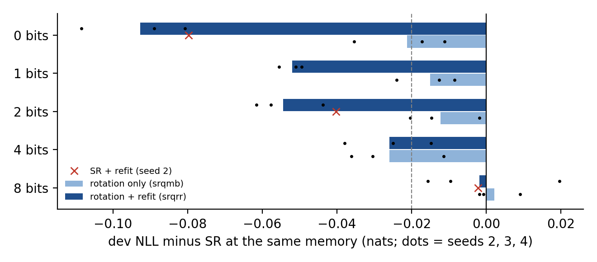

# Rotation Rounding and Level Refitting for Low-Memory Training of Quantized Weights

## Abstract
We consider training a network whose deployed weights are 4-bit codes, when the optimizer may keep at most b extra bits per weight, b ∈ {0, 1, 2, 4, 8}. The standard method at every b is stochastic rounding (SR) of the update onto the 2^−b grid. We show that the accumulated rounding error of SR is a random walk whose step variance can be reduced, with no extra memory and no loss of per-step unbiasedness, by replacing the i.i.d. threshold with a golden-ratio rotation regenerated from a seed. The removed fraction is a quadrature error, and we bound it by Koksma–Hlawka. We then add a stateless refit of the format's group scales, which averages gradient noise over 32 weights per parameter. On Pythia-14m with group-32 4-bit weights, with all settings fixed in advance and inherited from tuned SR, the combination lowers dev NLL by 0.093, 0.052, 0.054 and 0.026 nats at b = 0, 1, 2 and 4, better on all three seeds at each b (seed 2 was also used to tune SR's lr; seeds 3–4 were used for no choice). At b = 8 it ties SR (−0.002, 2/3), as the analysis predicts for rounding and as a level refit cannot overcome.

## I. Problem
Each quantized matrix stores codes c_ij ∈ {0, …, 15} and one scale θ_g per 32 columns; the deployed weight is W_ij = θ_{g(j)}(c_ij − 7.5). We call this decode(c, θ). Between steps, the optimizer may keep a b-bit fraction f_ij on the grid qℤ, q = 2^−b. Its position in level units is then x = c + f, and only c is deployed. Each step sees one batch of B = 8 sequences.

**Definition 1 (b-bit counter).** Given batch gradient g and level spacing Δ, a counter step forms

$$\tilde x = x - \eta\, g / (\mathrm{rms}(g)\,\Delta),$$

rounds x̃ to the grid qℤ by a threshold rule, and stores c = round(x), f = x − c.

Write y = x̃/q, ℓ = ⌊y⌋ and p = y − ℓ ∈ [0, 1). A threshold rule rounds up iff u < p, and its error in grid units is e = 1[u < p] − p. SR draws u ∼ U[0, 1) i.i.d. at every step. Since the stored value is the rounded one, after N steps

$$x_N = x_0 + \textstyle\sum_t \delta_t + q\sum_{t<N} e_t,$$

and SR's rounding displacement is a martingale with $\mathrm{Var} = q^2 \sum_t \mathbb E[p_t(1-p_t)]$. In effect, SR adds a random walk of per-step variance ≈ q·η|δ| to every weight, which the loss curvature can only hold back. This sets SR's error floor, and it dominates at small b.

## II. Rotation rounding
**Definition 2.** Let φ = (√5 − 1)/2. Weight i's threshold at step t is u_{i,t} = frac(u_{i,0} + tφ). Here u_{·,0} is drawn from a fixed per-matrix seed and regenerated every step, so it is never stored.

Observe that each u_{i,t} is marginally uniform over u_{i,0}, so every step is unbiased exactly as in SR, and different weights stay independent. What changes is the time structure of one weight's thresholds.

**Proposition 1.** Suppose the fractional parts p_t of one weight are i.i.d., independent of the thresholds, with survival function F(u) = P(p > u). Let ρ = Var_{u∼U} F(u) / E[p(1 − p)] ∈ [0, 1]. Then SR gives Var(Σ_{t<N} e_t) = N·E[p(1 − p)], and rotation gives

$$\mathrm{Var}\Big(\sum_{t<N} e_t\Big) = N(1-\rho)\,\mathbb E[p(1-p)] + O(\log^2 N).$$

*Proof.* Since E[1[u < p] | u] = F(u) and ∫F = E p, write e_t = m_t + (F(u_t) − E p), where m_t = e_t − E[e_t | u_t]. The m_t are independent and zero-mean under both rules, with E m_t² = E[p(1 − p)] − Var F. Under SR the second term is i.i.d. with variance Var F. Under rotation it is deterministic given u_0, and its sum is N times the quadrature error of F on {u_t}. F is monotone, so V(F) ≤ 1, and the golden rotation has star discrepancy N D*_N = O(log N). By Koksma–Hlawka, |Σ(F(u_t) − E p)| ≤ V(F)·N D*_N = O(log N). ∎

Note the two ends.
- **ρ = 1** for a deterministic increment, F = 1[u < p₀]. Rotation is then an equidistributed Σ-Δ modulator and the error stays O(log N).
- **ρ = ½** for an increment spread much wider than q, since F = 1 − u gives Var F = 1/12 against E[p(1 − p)] = 1/6.

With φ = 0 (frozen dither), the deterministic sum grows like N(F(u_0) − E p): a linear per-weight bias. Thus the gain requires a low-discrepancy orbit, not merely correlated thresholds.

**Closed loop.** In training, p_t depends on past rounding through the loss, so Proposition 1 holds only approximately. In a one-weight quadratic model, using the counter and the best η for each rule, rotation lowers risk at step 600 by 25% at b0, 24–26% at b1, 21–25% at b2 and 7% at b4, and ties at b8 (s = 3 and s = 10). The gain shrinks with b because the rounding variance q·η|δ| falls below the gradient-noise term η s²/2. At b8 a margin therefore needs less gradient noise, not better rounding.

## III. Stateless level refit
The scales θ are part of the deployed weight, so updating them adds no per-weight state. With codes fixed, ∂W_ij/∂θ_g = (c_ij − 7.5)·1[j ∈ g] =: M_g,ij. From the same B per-sequence gradients g_b, we form

$$a_b = \langle g_b, M_g\rangle,\quad \bar a = \tfrac1B\textstyle\sum_b a_b,\quad V = \widehat{\mathrm{Var}}(\bar a),\quad \mu = \bar a\,\frac{\sigma^2}{\sigma^2+V},$$

where σ² = mean_rows max(0, ā² − V) is the prior variance estimated from the same batch. The step is

$$\Delta\theta_g = -\kappa\,\frac{\eta_t}{\eta_0}\,\frac{\mu}{\alpha H_g},\qquad |\Delta\theta_g|\le 0.05|\theta_g|,$$

with H_g the diagonal Fisher along M_g. Each θ_g aggregates 32 weights, so its gradient noise is far smaller than a single weight's, and θ moves continuously, so it integrates the gradient over steps. It is the one deployed quantity in which a stateless rule can average noise. We fix κ = 0.003 and α = 3 from the earlier stateless study in this same setting (κ chosen from three values on seed 1 at 2-bit and seed 2 at 4-bit), and we tune nothing new here.

**Definition 3 (srqrr).** *State per matrix k (rows r, columns j, groups g of 32 columns).*
- Codes c_rj ∈ {0, …, K−1}, with K = 16.
- Scales θ_rg > 0, so the deployed weight is W_rj = θ_{r,g(j)}(c_rj − (K−1)/2).
- A counter f_rj ∈ qℤ ∩ [−½, ½ − q], with q = 2^−b, stored as a b-bit integer (f ≡ 0 at b = 0).

Of these, only f is optimizer memory: b bits per weight.

*Constants.*
- The step index t, the base lr η₀ and the schedule η_t.
- φ = (√5 − 1)/2 and a fixed seed σ_k per matrix.
- κ = 0.003, α = 3 and the cap γ = 0.05.

Each step takes a batch of B sequences with per-sequence losses L_b and performs steps 1–5. Each step is followed by its motivation.

**1. Gradients.** g_b = ∇_W L_b for each sequence, and G = (1/B) Σ_b g_b.
*Motivation.* G is the usual minibatch gradient, so the codes see the same signal as in SR. The individual g_b are kept only for step 4, which needs the spread across sequences to tell signal from noise. No other step uses them.

**2. Code move.** With level spacing s_rj = θ_{r,g(j)} and rms(G) taken over the matrix,
$$\tilde x = \mathrm{clip}\big(c + f - \eta_t\,G/(\mathrm{rms}(G)\,s),\;0,\;K-1\big).$$
*Motivation.*
- Dividing by s measures the step in levels, so η is the number of levels a typical weight moves per step, at every scale.
- Dividing by rms(G) makes that step size the same for every matrix, whatever its gradient scale.
- This is exactly SR's update. Steps 2 and 5 are shared with the baseline, so any difference comes from steps 3 and 4.

**3. Rotation rounding.** Draw u⁰ ∼ U[0,1)^{R×C} from a generator seeded with σ_k. It is the same at every step and is never stored. Set u = frac(u⁰ + tφ), y = x̃/q and ℓ = ⌊y⌋. Then
$$\hat x = \mathrm{clip}\big(q(\ell + \mathbb 1[u < y-\ell]),\,0,\,K-1\big),\quad c' = \lfloor \hat x + \tfrac12\rfloor,\quad f' = \hat x - c'.$$
*Motivation.* x̃ must be stored on the b-bit grid, so it must be rounded.
- **Unbiased like SR.** A random threshold makes each step unbiased (E x̂ = x̃), so small updates are not lost. For each weight, u is uniform over u⁰, so this holds for rotation exactly as for SR.
- **Better than SR over time.** SR draws a fresh u every step, so one weight's rounding errors add up as a random walk. That walk is SR's error floor (§I). The rotation spreads one weight's thresholds evenly over [0,1), so its errors cancel over time. This removes the fraction ρ ∈ [½, 1] of SR's accumulated rounding variance (Proposition 1).
- **Why φ.** The golden ratio gives the most even spread (lowest discrepancy). φ = 0 (a fixed threshold) instead gives each weight a bias that grows linearly in t, and training collapses.
- **No memory.** u⁰ is regenerated from the seed, so the rotation adds no state.
- **The split into c′ and f′.** The deployed code c′ is the level nearest x̂, and f′ keeps the progress below one level, which is what the b bits are for.

**4. Level refit.** Let M_{rg,j} = (c_rj − (K−1)/2)·1[j ∈ g], built from the codes *before* step 3. For each (r, g),
$$a_b = \langle g_{b,r\cdot}, M_{rg}\rangle,\quad \bar a = \tfrac1B\textstyle\sum_b a_b,\quad V = \tfrac{1}{B(B-1)}\textstyle\sum_b (a_b-\bar a)^2,$$
$$\sigma^2_g = \mathrm{mean}_r \max(0,\bar a^2 - V),\qquad \mu = \bar a\,\sigma^2_g/(\sigma^2_g + V).$$
H_rg is the diagonal curvature of the mean loss along M_rg: factored empirical Fisher for hidden matrices, exact Gauss–Newton for the output head, and occurrence-wise Fisher for the embedding. Then
$$\Delta\theta = \mathrm{clip}\Big(-\kappa\,\frac{\eta_t}{\eta_0}\,\frac{\mu}{\alpha H},\;\pm\gamma|\theta|\Big),\qquad \theta' = \max(\theta + \Delta\theta,\,10^{-6}).$$
*Motivation.* Steps 2–3 cannot reduce gradient noise: each weight's update uses only this step's gradient, and the only memory is b bits. The scales θ are the one place a memoryless rule can average noise.
- **θ averages across weights.** It is part of the deployed weight, so updating it costs no memory. One θ_rg pools 32 weights, and its gradient is ā = ∂L/∂θ_rg, since ∂W/∂θ_rg = M_rg.
- **θ averages over time.** It is continuous, so small consistent gradients accumulate in it, whereas the codes only move in whole levels.
- **Shrinkage.** V is the batch estimate of ā's noise variance, and σ²_g is the spread of the true signal across rows. μ is then the empirical-Bayes posterior mean of the true gradient: it keeps groups with a clear signal and shrinks groups that are mostly noise.
- **Newton scaling.** Dividing by H makes Δθ a Newton step, so its size does not depend on the layer's scale.
- **Small, safe steps.** κ/α is small because H is a diagonal approximation and the step comes from a single batch. The cap γ stops any group's scale from changing by more than 5% in one step when H is underestimated. η_t/η₀ makes the refit decay with the learning rate.
- **Old codes in M.** g_b was evaluated at the old codes, so building M from them keeps step 4 a valid first-order step.

**5. Commit.** Store c′, f′ and θ′, then increment t.

**Special cases.** Each one changes only what the steps above isolate:
- Replace the rotation u with an i.i.d. uniform u and remove step 4: this is SR (`--method sr`).
- Remove step 4 only: rotation alone (`--method rotation`).
- Use an i.i.d. u and keep step 4: the SR + refit ablation (not in this code).

At each b the learning rate is SR's tuned value. The code is [srqrr.py](srqrr.py), class `SRQRR`; `python train.py run --method srqrr` runs it.

## IV. Experiments
**Setup.** Pythia-14m, starting from a 4-bit group-32 fit (one source per seed), continued on wikitext for 600 steps at B = 8, T = 128, with a cosine-half schedule. We report dev NLL at step 600. The baseline at each b is SR with the same normalized update and the same memory: SR of the codes at b = 0 (lr 1e-4) and the b-bit SR counter at b ≥ 1 (both `--method sr`). SR's lr was tuned per b over {1e-4, 3e-4, 1e-3, 3e-3}: 3e-4 at b = 1, 2 and 3e-3 at b = 4, 8. Our methods inherit these lr values. κ, α and the cap come from the earlier stateless study. φ is fixed by the theory.

**Pre-registration.** Before running, we fixed seeds 2–4 and the criterion. Seed 2 is not clean: SR's lr was tuned on it, and κ was chosen on it from {0.001, 0.003, 0.01} for an earlier stateless rule of ours at b = 0. Seeds 3 and 4 were used for no choice. On seeds 3–4 alone the gaps are −0.081/−0.109, −0.051/−0.056, −0.044/−0.058, −0.025/−0.015 and −0.016/+0.020 at b = 0, 1, 2, 4, 8, so the conclusions at b ≤ 2 are unchanged and b = 4 is weaker (one seed above −0.02). The method, its components and κ were all developed on this model, format, task and dev split, and the reported numbers use that same dev split. We fixed: at each b, the mean paired gap is ≤ −0.02 nats and ours is better on 3/3 seeds. We also fixed the arms and the ablations. The sealed test split is untouched.

*Fig. 1. Dev NLL minus same-memory SR, seed-paired. Dark bars: rotation rounding plus level refit (srqrr). Light bars: rotation alone. Crosses: SR plus level refit (seed 2). Dashed line: the −0.02 criterion. Observe that rotation alone gains most at small b except b0. The refit adds a roughly constant 0.04–0.07 at b ≤ 2 and nothing at b ≥ 4. Neither moves b = 8 beyond seed noise.*

| b (bits/weight) | SR | srqrr | paired gap (seeds 2, 3, 4) | mean | better | criterion |
|---|---|---|---|---|---|---|
| 0 | 5.242 | 5.149 | −0.089, −0.081, −0.109 | **−0.093** | 3/3 | met |
| 1 | 5.190 | 5.138 | −0.049, −0.051, −0.056 | **−0.052** | 3/3 | met |
| 2 | 5.075 | 5.020 | −0.062, −0.044, −0.058 | **−0.054** | 3/3 | met |
| 4 | 4.931 | 4.905 | −0.038, −0.025, −0.015 | **−0.026** | 3/3 | met |
| 8 | 4.866 | 4.864 | −0.010, −0.016, +0.020 | −0.002 | 2/3 | **not met** |

*Table I. Dev NLL at step 600, means over seeds 2–4. For reference, Adam (fp32 moments, 8 bytes/weight of state) reaches 4.960, so srqrr at b = 4 is 0.055 below Adam at 0.5 bytes/weight.*

**Attribution.**
- *Rotation alone* gives a paired gap of −0.021, −0.015, −0.012, −0.026 and +0.002 at b = 0, 1, 2, 4, 8. It is better on 3/3 seeds at b ≤ 4 and on 1/3 at b = 8. This confirms the sign predicted in §II and the tie at b = 8. The ordering across b is not the monotone one the one-weight model predicts: the b = 4 gain exceeds the b = 1, 2 gains on GPU.
- *SR + refit* (seed 2) gives −0.080 at b = 0, −0.040 at b = 2 and −0.002 at b = 8. Adding rotation on top improves it further by 0.009, 0.021 and 0.007. Thus the two components are roughly additive at b ≤ 2, and the refit is the larger one there.
- *Controls.*
  - With φ = 0 (frozen dither) training collapses (b = 1: 6.20; b = 4: 7.06), as the linear bias term predicts.
  - Rotation keeps its lead under an lr change (lr 1e-3, seed 2: better at b = 1, 2, 4, 8) and over 2,400 steps (b = 4: 4.960 vs 4.986). It loses at an lr far below SR's optimum (b = 4, lr 3e-4: 5.046 vs 5.037).
  - At b = 1, lr 1e-4, rotation ties SR. Rounding is then a small part of the step.

**Why b = 8 resists.** With q = 2^−8 the rounding variance q·η|δ| is negligible against gradient noise, so Proposition 1 has nothing left to remove. The refit's noise averaging is spread over ~1/32 of the parameters, and its benefit shrinks once the codes themselves move accurately (b ≥ 4: the SR+refit gap is −0.002). Beating SR at b = 8 therefore requires reducing gradient noise in the per-weight update itself. One way is to spend some of the 8 bits on a gradient average rather than on position precision. We have not tested this.

## V. Conclusion
We showed that SR's accumulated rounding error contains a quadrature term, and that a seeded golden rotation removes it at zero memory while keeping each step unbiased (Proposition 1). Together with a stateless refit of the format's scales, this beats SR by 0.026–0.093 nats at 0–4 extra bits per weight on every seed, with no parameter tuned for this study (κ and the lrs carried over from earlier work in the same setting, partly chosen on seed 2). At 8 bits rounding is no longer the bottleneck and the method only ties SR.

**Scope.** These results come from one model (14m), one format and one task, over 600 steps, with three seeds per b. The closed-loop dynamics are checked only in simulation. At b = 0 an earlier stateless rule of ours (gauss3r, 5.100; not included here) is still better than srqrr (5.149). The rotation's advantage over SR at b = 0 is therefore relevant only for SR-style updates.

---
*Per-seed numbers:* [results/results.csv](results/results.csv). *Code:* [srqrr.py](srqrr.py) (`SRCounter`, `RotationCounter`, `SRQRR`), [train.py](train.py).
